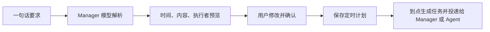

# 自然语言定时任务（#4094）

在「定时任务 → 新建」输入“每天上午 9 点让 Manager 整理待办”，先解析，核对或修改表单，再保存。也可在 Manager 对话中提出要求，查看预览后回复确认。



## 接口与模块

| 入口 | 行为 |
| --- | --- |
| `POST /api/v1/scheduled-tasks/parse` | 输入 `text`、`time_zone`、可选 `default_agent_id`；返回草稿及 `client_request_id`，无法确定时返回 `clarification`；不保存、不执行工具 |
| `POST /api/v1/scheduled-tasks` | 保存确认后的 `title`、`prompt`、`agent_id`、`recurrence`、`first_run_at`、`time_zone`；沿用预览的 `client_request_id`，相同请求重试返回原计划 |
| Manager MCP | `scheduled_task_parse` → 展示结果并等待用户确认 → `scheduled_task_create`（`confirmed=true`）；`scheduled_tasks_list` 查询已保存计划 |
| `internal/scheduledtask` | 解析结果校验、计划持久化、重复提交检查、到点触发；复用 `internal/agenttask`，保留 Manager 身份 |

解析使用 Manager 当前模型配置；缺模型时可继续手填。普通 Agent 的运行凭据不能管理定时计划；网页仍使用现有用户鉴权。对话确认由 Manager 指令与单独创建工具约束，`confirmed` 不是服务端独立验证的用户签名。

## 时间与确认规则

- 支持单次、每天、每周、每月；缺少时间、执行者不明确或无法表达的周期先追问，不直接保存。
- 网页默认浏览器时区；解析 API / CLI 未指定时区默认 UTC，跨端使用显式 IANA 名称，例如 `Asia/Shanghai`。
- 时间保存为 RFC3339，并另存时区；重启后的每日/每周计算使用原时区。每月沿用原调度器，解析遇到每月 29～31 日会要求改为 1～28 日或单次日期；暂不支持“每月最后一天”。
- 解析阶段只返回数据；保存不立即执行。到点后生成任务与执行记录，运行失败可在原任务界面查看。
- 同一 `client_request_id` 内容相同只建一次；内容不同返回错误，需重新解析生成新草稿。

## CLI 示例

```sh
csgclaw-cli task schedule parse --text '每天上午9点让Manager整理待办' --timezone Asia/Shanghai > preview.json
# 展示 preview.json，等待用户确认；如需调整，先编辑该文件。
csgclaw-cli task schedule create --file preview.json --confirmed
csgclaw-cli task schedule list
```

已用模拟模型测试解析、追问、错误输出、确认前不保存、重复请求、Manager 投递及跨时区日期；真实模型的语义理解和实际定时执行效果仍需用测试账号验收。
