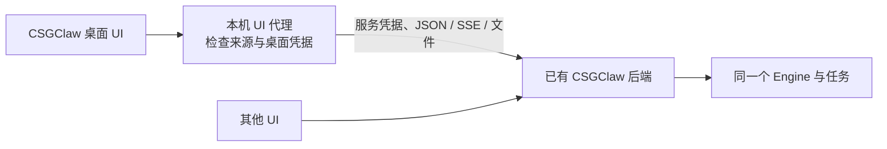

# 0.10：CSGClaw 端实施与对接

本分支只修改 CSGClaw；云端权限、实例、配额和发布目录由 CSGHub Server / Portal 接入。

## CL-01：独立后端

```sh
make build-headless
./bin/csgclaw-headless serve --no-browser
# 普通二进制也可只提供 API
./bin/csgclaw serve --api-only
# 单独镜像，无 Web 构建阶段
# docker build -f Dockerfile.headless -t csgclaw-headless .
```

`headless` 编译标签完全移除网页嵌入依赖；`--api-only` 控制运行时路由。两种方式都保留 Agent、IM、会话和后台业务，关闭网页兜底、本机目录选择和文件打开动作。后台启动会保留该选项，`--browser` 不会打开空网页。

独立后端镜像预装 Node / Python、配套 CLI 和与普通构建相同的 Codex；DSH 使用已有安装接口或由部署镜像提供，并以实际检测结果为准。API-only 同时关闭启动时的自动浏览器登录。

## CL-01：连接外接 UI

```sh
csgclaw serve --api-only --ui-origins http://localhost:5173
```

外接网页宿主在加载应用前提供连接设置：

```js
globalThis.CSGCLAW_CONNECTION = {
  api_base: "http://127.0.0.1:8080/api/v1/",
  event_base: "http://127.0.0.1:8080/api/v1/",
};
```

API、流式回复、IM 事件、文件和上传共用地址配置，保留部署子路径。现有未配置的页面继续使用相对地址；不同后端的 SharedWorker 连接互相隔离。宿主切换后端后应重新加载页面，不能沿用上一后端的业务缓存。

连接方式有两种：同域代理保管服务 Token；或客户端用 Bearer 连接明确允许的来源。浏览器可用 Token 调用 `POST /api/v1/control/pair`，换取 HttpOnly / SameSite=Strict 的 12 小时 Cookie；`POST /api/v1/control/logout` 撤销，服务重启也会撤销。前端 `pairBackend` / `unpairBackend` 不把 Token 放进 URL 或本地存储。

严格同站 Cookie 不适用于任意跨站网页；这种部署使用同域代理。浏览器跨域请求必须显式携带凭据，不能配置 `*` 来源；配对不等于 OpenCSG 账号登录。Electron 原有来源与双监听端口检查保留，外接模式由宿主连接已有服务。

## CL-01：桌面连接已有后端

宿主可配置 `CSGCLAW_DESKTOP_BACKEND_API_BASE`（例如 `https://service.example/api/v1/`）和 `CSGCLAW_DESKTOP_BACKEND_TOKEN`。默认不设置时仍启动原本的本地服务。



连接模式先验证受保护的 `GET /api/v1/control/capabilities`，只接受协议版本 1。桌面启动的子进程只提供网页和转发，不初始化配置、Agent 或 IM，也不争抢已有后端的实例锁；凭据经私有 stdin 管道交给代理，不进启动参数、渲染器或日志。

代理保留原桌面的 Host / Origin / CSP 约束，另外检查随机桌面凭据；移除浏览器 Cookie、替换转发凭据，拒绝远端机器上的“打开文件 / 选择目录”。退出或重启桌面只关闭 UI 代理，不关闭已有后端；后端进程仍由原部署方管理。云端网关需授权转发握手与相应 API，不能靠客户端任意指定内部目标。
## CL-02：共用接口

下面均接在 `/api/v1/agents/{id}` 后，要求服务凭据；平台仍须先检查用户与实例归属。

| 接口 | 行为 |
| --- | --- |
| `GET /capabilities` | 后端身份、协议版本 1、真实 Engine 能力、Agent 就绪状态 |
| `GET/PATCH /configuration` | `expected_revision + field_mask + spec`；过期 409；不返回凭据、启动脚本、模型环境变量和 MCP 凭据 |
| `POST /configuration:apply` | 核对版本后重新应用；明确区分未就绪、需要重启、已生效 |
| `POST /files?name=...`；`GET/DELETE /files/{file_id}` | 二进制上传上限 32 MiB，Agent 内归属检查；执行已引用的文件拒绝删除 |
| `PUT/DELETE /workspace/file?path=...` | 相对路径、拒绝符号链接，带当前 SHA-256 的 `If-Match`；新文件用 `*` |
| `GET /sessions`；`GET /sessions/{s}/history` | 公共会话索引；历史 `limit` 1–100，`before` 使用上一页最旧 turn ID |
| `POST /sessions/{s}/turns` | `request_id + input`；202 只在 Engine 接纳后返回，断开网页不取消执行 |
| `GET .../turns/{t}`；`POST .../turns/{t}/cancel` | 查询原执行或取消，复用 Engine 的执行与交互规则 |
| `GET .../interactions/{i}`；`POST .../interactions/{i}/resolve` | 查看并回答确认，同一个确认由 Engine 接受首份有效结果 |
| `GET /events`；`GET .../turns/{t}/events?after=序号` | 前者提醒重读状态，后者实时只读观察同一次执行，不再次调用 Run |

工作配置版本覆盖 Agent 记录及实际 Skill 列表，并在现有生命周期锁内比较；旧入口的配置变化同样使版本失效。普通 Web 会收到 Agent 更新事件。MCP 凭据不经通用配置读取；原 Web 编辑器也携带打开草稿时的版本，冲突后保留草稿。后端记录最近确认生效的版本，后续应用失败时仍可查询它。

IM、旧 responses 和新 turns 最终都进入同一个 Engine；IM 的 room/task 会话通过稳定的 `observed.*` 别名只读列出，历史不各存一份；继续聊天仍走原消息 API，保留频道自身的记录、授权与投递。执行请求、最终结果、事件和文件随控制数据目录保存；进度在运行时实时订阅，崩溃后的未完成执行标记 `execution_unknown`，绝不自动重跑外部工具。

`/healthz` 只检查进程；受保护的 `/readyz` 检查服务配置和控制存储，具体 Agent 能否执行以 capabilities 为准。本地与云端各自部署，共用代码，不自动复制两台机器的数据。

## AH-05：模板依赖与运行检查

模板 `agentfile.toml` 可新增以下可选内容，旧模板无需修改：

```toml
[[dependencies]]
name = "node"
min_version = "22.13.0"

[[dependencies]]
name = "python"
min_version = "3.10"
optional = true
```

支持 node、python（python3）、npm、git、bash、uv；只执行固定的版本查询，不接受模板提供的安装命令。依赖随模板读写、导入、Agent 保存和再次导出保留；宿主模式创建模板时检查必需依赖，缺项不静默换执行程序。

- `POST /api/v1/hub/templates/{id}/preflight`：返回缺失或版本不符的工具，以及此服务真正安装的执行程序。
- `GET /api/v1/agents/{id}/readiness`（也可 `POST .../preflight`）：核对 Agent 状态、声明依赖、模型配置和目录可写性。

预检不发起付费模型请求，也不把“模型已配置”当作模型/MCP 网络已验证；响应明确给出 `model_probe / mcp_probe = not_performed`。外层沙盒的工具未实际探测时返回 `sandbox_probe_required`，不能用宿主机的 Node/Python 版本冒充沙盒环境。

CPU/内存是否充足、实例休眠唤醒、发布范围、自定义页面和市场注册属于 Server / Portal；这些能力不在 CSGClaw 服务里伪造。
